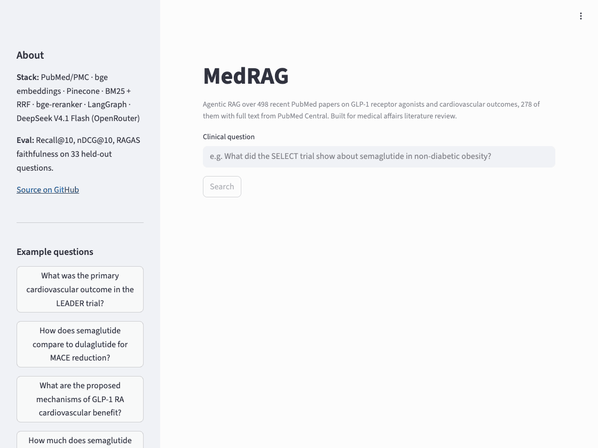
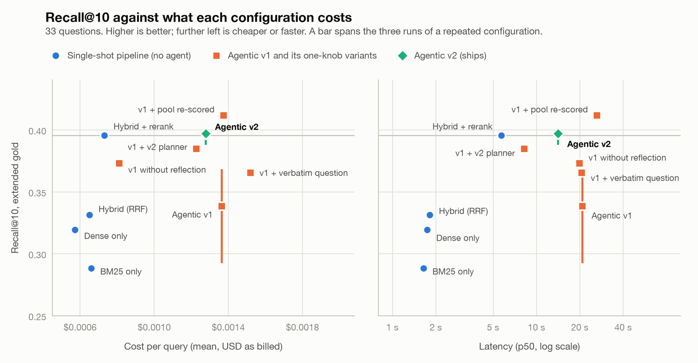

# MedRAG — Agentic RAG over GLP-1 Cardiovascular Outcome Literature

> Medical affairs teams answer literature questions from field medical
> liaisons, and each one means finding and reading the papers by hand.
> **MedRAG returns a cited answer in about 14 seconds** (median over the 33
> evaluation questions) from 498 recent PubMed papers on GLP-1 receptor
> agonists and cardiovascular outcomes, 278 of them indexed in full text.

[](https://github.com/SachiK0thari/medrag/actions/workflows/ci.yml)
[](https://www.python.org)
[](https://github.com/astral-sh/ruff)
[](https://mypy-lang.org)

**Live demo:** [huggingface.co/spaces/SachiK/medrag](https://huggingface.co/spaces/SachiK/medrag)



<sub>Recorded from the app running locally (`python scripts/record_demo.py`).
The wait is shortened in the recording; the latency shown in the app is the
real one for that query.</sub>

---

## Key finding: the first agent made retrieval worse, and the traces showed why

**In short:** I put an LLM agent on top of a search pipeline, measured it, and
found it retrieved worse than the pipeline alone. The saved traces pinned
that on one bug in how the agent merged its search results. With the bug
fixed the agent matches the pipeline and does not beat it: on these
questions it adds a step-by-step trace and no retrieval quality.

The evaluation compares two ways of answering a question. A **single-shot**
pipeline retrieves once and answers; the strongest one (BM25 + dense search,
fused, then reranked by a cross-encoder) is the baseline. The **agent** wraps
that baseline in an LLM loop that plans sub-queries, retrieves for each, and
checks whether the evidence is sufficient before answering.

33 held-out GLP-1 / cardiovascular questions and ten configurations, with
`deepseek/deepseek-v4.1-flash`. The three agentic rows below are means of
three runs each. The results and per-step traces are committed, so every
evaluation number in this README regenerates offline in a few seconds:

```bash
python scripts/analyze_eval.py                        # full-text run, deltas against the baseline
python scripts/analyze_eval.py --baseline agentic_v2  # the same run against v2 (`agentic` for v1)
python scripts/analyze_eval.py --results data/eval_results_abstracts.csv \
    --traces data/eval_traces_abstracts.jsonl --no-extension    # abstracts-only run
```

| Config | Recall@10 | vs baseline (95% CI) | MRR | RAGAS faithfulness | p50 latency | $/query |
|---|---|---|---|---|---|---|
| BM25 only | 0.288 | −0.107 (−0.141 to −0.075) | 0.605 | 0.964 | 1.6 s | $0.00066 |
| Dense only | 0.320 | −0.076 (−0.134 to −0.024) | 0.758 | 0.961 | 1.7 s | $0.00057 |
| Hybrid (RRF) | 0.332 | −0.064 (−0.101 to −0.030) | 0.826 | 0.966 | 1.8 s | $0.00065 |
| Hybrid + rerank (baseline) | 0.396 | — | 0.869 | 0.984 | 5.7 s | $0.00073 |
| Agentic v1 (original loop) | 0.338 | −0.057 (−0.102 to −0.015) | 0.716 | 0.956 | 20.8 s | $0.00136 |
| v1 + merged pool re-scored | 0.412 | +0.016 (−0.023 to +0.053) | 0.818 | 0.971 | 26.3 s | $0.00137 |
| **Agentic v2 (ships)** | 0.397 | +0.001 (−0.019 to +0.018) | 0.875 | 0.966 | 14.1 s | $0.00128 |

Recall is scored on the papers behind the 10 chunks the answer is written
from, against the curated gold labels plus the papers graded after the corpus
gained full text. Both choices are explained under
[How far to trust the evaluation numbers](#how-far-to-trust-the-evaluation-numbers).

The original agentic loop scores **below** the hybrid + rerank pipeline it
wraps, at more than three times the latency. That first showed on the
abstracts-only corpus the agent was built on, where the gap was 0.20 recall
(95% CI −0.33 to −0.08), and a one-knob-at-a-time ablation over the saved
traces located the cause:

| Abstracts-only corpus | Gold papers found by a sub-query | Gold papers in the final top 10 |
|---|---|---|
| Hybrid + rerank (no agent) | — | 57 / 90 |
| Agentic v1 | 69 / 90 | 40 / 90 |
| v1 + merged pool re-scored against the question | 75 / 90 | 59 / 90 |
| v1 + planner told not to pad the query list | 64 / 90 | 58 / 90 |

The agent's sub-queries *found* more gold papers than the baseline. It then
discarded them: each sub-query's results were reranked against that sub-query
and the lists were merged by score, but cross-encoder scores computed against
different queries are not comparable. Either fix alone restored baseline
recall. Reflection, the usual suspect, turned out not to matter.

The diagnosis held when the corpus was re-ingested with full text (the first
table). v1 is still below the baseline, by 0.06 recall, and it is the one
config whose score swings from run to run (0.29, 0.35, 0.37), because a merge
on incomparable scores depends on which sub-queries the planner happens to
write. Re-scoring the merged pool recovers the loss. This full-text result is
measured on the extended gold labels. The original 90 labels alone cannot
separate v1 from its fixes there, as the
[trust section](#how-far-to-trust-the-evaluation-numbers) sets out.

The fixed agent **matches** the single-shot pipeline and does not beat it:
recall differs by +0.001 over three runs, at 2.5× the latency. Four
sub-queries with the fixed merge do no better than v2's one restatement
(+0.015, 95% CI −0.023 to +0.051). On this question set the loop buys a
per-step trace and no retrieval quality. The full analysis of both corpora is
in [`docs/eval_findings.md`](docs/eval_findings.md).

### What full text did for the answers

| Agentic v2, 33 questions | Abstracts only | Full text |
|---|---|---|
| Answers that quote a 95% confidence interval | 5 | 17 |
| Answers that say the sources lack the information | 17 | 3 |
| RAGAS faithfulness | 0.912 | 0.966 |

Asked how semaglutide affected MACE in SUSTAIN-6, the abstracts-only system
answered that its sources did not contain the hazard ratio. It now answers
"HR 0.74, 95% CI 0.58–0.95", cited. Two changes did this together: article
bodies are indexed, and the answer prompt carries each source in full where
it used to cut it at 600 characters, which is before an abstract reaches its
results.

### Cost against quality

<picture>
  <source media="(prefers-color-scheme: dark)" srcset="docs/eval_cost_quality_dark.png">
  
</picture>

All ten configurations, including the three one-knob ablations the first
table leaves out (`python scripts/plot_eval.py`). The agentic variants that
carry a fix sit level with the baseline at 1.7 to 1.9 times its cost and 1.4
to 4.6 times its latency. The four single-shot configs make the same single
LLM call on near-identical token counts, so the differences in their cost
come from how OpenRouter billed each call, not from the retrieval method.

## What it does

Given a clinical question (e.g. *"How did semaglutide affect MACE in SUSTAIN-6?"*),
MedRAG:

1. **Plans** the search with an LLM: atomic questions are searched as asked,
   and only genuinely multi-part questions are split into sub-queries.
2. **Retrieves** relevant chunks from 498 PubMed papers, 278 of them in full
   text (8,647 chunks), using a hybrid BM25 + dense pipeline fused via
   Reciprocal Rank Fusion.
3. **Reranks** the merged candidates against the original question with a
   cross-encoder (bge-reranker-v2-m3).
4. **Reflects** on whether retrieved evidence is sufficient; re-retrieves if not.
5. **Answers** with inline citations grounded in specific source chunks,
   returned as a strict Pydantic model.

Every step is type-checked, traced (latency + token spend), and evaluated.

## Architecture

See [`docs/architecture.md`](docs/architecture.md) for the full diagram.

```
question → decompose → [BM25 + dense → RRF → rerank] → reflect → answer
                            │                              │
                            └── PubMed/PMC corpus          └── cited Pydantic Answer
```

## How far to trust the evaluation numbers

- **Gold labels are LLM-curated** from a pooled BM25 + dense candidate set
  (`scripts/curate_gold.py`). I hand-checked 28 of the 90 labels: none were
  irrelevant, 14 directly answer the question and 14 are only on topic.
- **The labels were chosen on the abstracts-only corpus, and full text
  outgrew them.** Of the 8 papers in the baseline's context, 1.3 carry one of
  those labels. A judge graded the rest from the abstract and the
  best-matching body passages (`scripts/extend_gold.py`): 1,427
  question–paper pairs covering 315 papers, of which 336 answer their
  question directly. Recall in the table counts those as gold; 13 already
  were, so 323 labels are new. I hand-checked a random 30 of the 336: 27 answer their question,
  3 are only on topic and none is irrelevant. That is 90% agreement; with 30
  papers the true rate could be anywhere from 74% to 97%.
- **Retrieval is scored on what the answer saw:** the distinct papers behind
  the 10 chunks the answer is written from, about 8 papers. Scoring each
  config's whole ranking compared lists of different lengths.
- **Scores from before and after the re-ingest are not comparable.** The gold
  set grew from 90 labels to 413, about 12 per question, and a context of 8
  papers cannot hold 12 gold ones. So this README does not claim that full text improved
  paper-level retrieval. The claim it makes is about the answers.
- **Run-to-run noise is measured, not assumed.** The three agentic rows were
  run three times. The two configs with the fixed merge moved by 0.01 between
  runs; v1 moved by 0.08. The other agentic ablations were run once.
- **What is robust** on both corpora and under every gold set: hybrid +
  rerank is the best single-shot config, and v2 matches the baseline. On
  abstracts, v1 is worse than the baseline and either fix removes the gap.
- **What rests on the extended labels:** the same v1 result on full text. On
  the extended set v1 is 0.057 below the baseline (95% CI −0.102 to −0.015).
  On the original 90 labels alone it is 0.064 below (−0.160 to +0.029) and
  the re-scored merge gains 0.012 over it (−0.052 to +0.077), so that set
  cannot separate v1 from its fixes. On its 18-question strict subset v1 is
  nominally ahead of the baseline (0.670 against 0.611).
- **What is not robust:** BM25 against dense. On abstracts the order flipped
  between gold sets. On full text dense is ahead on the original labels and
  inside the noise on the extended ones.

## Stack

| Layer | Choice | Why |
|---|---|---|
| Sources | PubMed and PMC through NCBI E-utilities | Free, structured, MeSH-tagged; PMC gives full text as XML, no PDF parsing |
| Embeddings | `BAAI/bge-small-en-v1.5` (local) | 384-d, CPU-friendly, top of MTEB at size |
| Vector DB | Pinecone (serverless) | Production-grade, free tier sufficient |
| Sparse | `rank_bm25` | Pure Python, zero deps |
| Rerank | `BAAI/bge-reranker-v2-m3` (local) | Cross-encoder precision boost |
| LLM | DeepSeek V4.1 Flash via OpenRouter | Cheap, fast, any OpenRouter model id via `LLM_MODEL` |
| Orchestration | LangGraph | Explicit state machine for agent loop |
| API | FastAPI + Pydantic | Type-safe contracts end to end |
| UI | Streamlit | Fast to ship, deploys to HF Spaces |
| Eval | Custom harness + RAGAS faithfulness | Recall@k, MRR, nDCG, graded gold, bootstrap CIs, per-step traces |
| Quality | ruff + mypy strict + pytest + GH Actions | Production-grade discipline |

The LLM client (`medrag.agent.llm`) talks to OpenRouter's OpenAI-compatible API, so
swapping to Claude, GPT, Llama, etc. is a one-line `LLM_MODEL` change.

## Quickstart

```bash
# 1. Install
git clone https://github.com/SachiK0thari/medrag.git
cd medrag
python -m venv .venv && source .venv/bin/activate
make dev   # installs with dev + eval extras, sets up pre-commit

# 2. Configure
cp .env.example .env
# Edit .env with your OpenRouter, Pinecone, and (optional) NCBI API keys

# 3. Ingest
make ingest        # search PubMed, fetch PMC full text, chunk, embed, upsert
make reingest      # later: rebuild the same papers in place (about 5 minutes)

# 4. Evaluate
make eval                        # writes data/eval_results.csv + eval_traces.jsonl
python scripts/analyze_eval.py   # tables, confidence intervals, agent attribution
python scripts/plot_eval.py      # docs/eval_cost_quality.png (light + dark)

# 5. Run
make api           # FastAPI on http://localhost:8000
make ui            # Streamlit on http://localhost:8501
```

Steps 3 and 4 are optional if you only want the numbers: the eval results are
committed, so `python scripts/analyze_eval.py` and `python scripts/plot_eval.py`
work straight after `make dev`, with no API keys.

## Project layout

```
medrag/
├── src/medrag/
│   ├── models.py           ← Pydantic data contracts
│   ├── config.py           ← All env vars + tunables
│   ├── ingestion/          ← PubMed → PMC → chunk → embed
│   ├── retrieval/          ← BM25 + dense + RRF + rerank
│   ├── agent/              ← LangGraph loop, prompts, LLM wrapper
│   ├── eval/               ← Metrics, harness, held-out questions
│   ├── api/                ← FastAPI service
│   └── ui/                 ← Streamlit demo
├── tests/                  ← pytest, runs in CI
├── scripts/                ← ingest, run_eval, analyze_eval, plot_eval, curate_gold, grade_gold, extend_gold, record_demo
├── data/eval_results.csv   ← Committed eval run (with eval_traces.jsonl and two repeat runs)
├── data/eval_*_abstracts.* ← The earlier run on the abstracts-only corpus
├── docs/architecture.md    ← System diagram + design rationale
├── docs/eval_findings.md   ← Why the agent regressed and what fixed it
├── .github/workflows/ci.yml← Lint + types + tests on every PR
├── Dockerfile              ← HF Spaces deploy target
└── pyproject.toml          ← Pinned deps, ruff/mypy/pytest config
```

## What I'd do differently

1. **Route instead of always looping.** v2 adds one restatement of the
   question and gets baseline retrieval for 2.5× the latency. When the planner
   has nothing to split, run the single-shot path and skip reflection.
2. **Add multi-hop questions.** Decomposition should earn its cost on
   questions with independent parts, and this set has almost none, so it can
   show the agent losing and cannot show it winning.
3. **Make the critic emit a search query.** Today the follow-up search uses
   the critic's complaint verbatim, and reflection has not moved recall on
   either corpus.
4. **Hand-check the papers the judge graded "related".** The sample of 30
   covered only its "direct" grades. A related paper that does answer its
   question is scored as a miss.
5. **Judge passages, not papers.** A config is credited for a paper whichever
   of its chunks it retrieved. The traces record the chunk IDs of every
   answer's context, so those chunks could be graded directly.
6. **Add the landmark trials.** The corpus is 498 PubMed records, nearly all
   from 2025 and 2026, so LEADER and SUSTAIN-6 (2016) are reported
   second-hand by the papers that cite them. And 220 of the 498 are still
   abstract only: 192 are not in PMC, and for 28 PMC holds no downloadable
   body.

## Engineering practices

- **Strict typing** — `mypy --strict` over the whole `src/` tree, Pydantic for
  every data structure crossing a module boundary.
- **Lint + format** — ruff with bugbear, simplify, pyupgrade, pep8-naming, annotations.
- **CI** — every PR runs ruff, ruff-format check, mypy strict, and pytest.
- **Tests** — 132 unit tests that run in under two seconds with no network and
  no model downloads. Line coverage is 78% overall and 94% on the agent graph;
  the uncovered code is mostly the network-bound retrieval clients.
- **Pre-commit hooks** — same checks locally before commit.
- **Reproducible ingestion** — papers are persisted to SQLite, and
  `make reingest` rebuilds full text, chunks and vectors for exactly those
  papers. A PubMed search is newest-first, so searching again would return a
  different corpus and orphan the eval's gold labels.
- **Trace-first observability** — every query produces a `QueryTrace` with
  per-step latency and token counts.
- **Versioned prompts** — `PROMPT_VERSION` in `agent.prompts` ensures eval results
  are tied to a specific prompt revision.

## Roadmap

- [ ] Cost vs quality embedding ablation (`bge-small` vs OpenAI `text-embedding-3-large`)
- [ ] Multi-topic ingestion (extend beyond GLP-1 / CV)

## License

MIT
